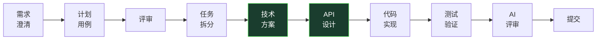
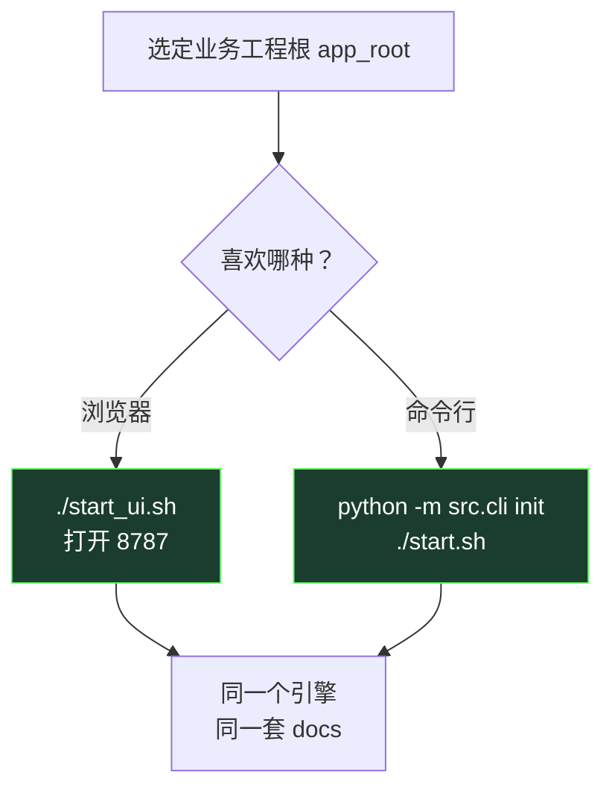
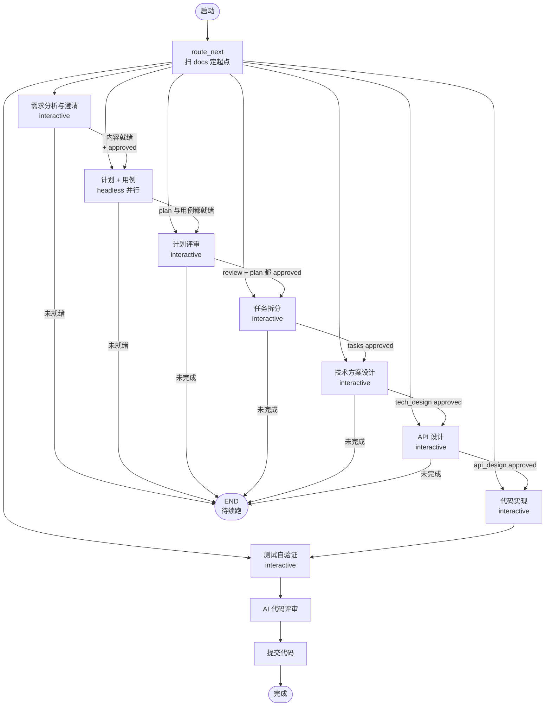
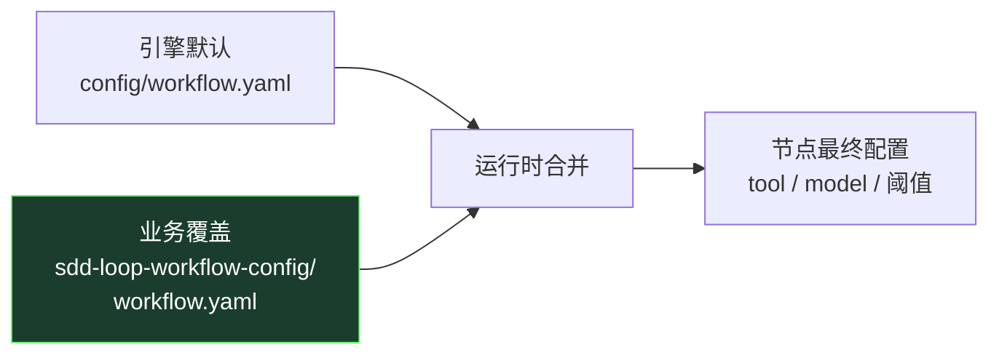
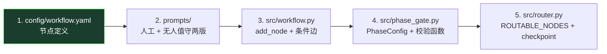

# AI4SE SDD Loop Workflow

把「一句需求」变成「可评审的代码」的工程化流水线。

每个阶段都由 AI Agent 完成，但**阶段之间不共享上下文** —— 只通过 `docs/` 下的 Markdown 传递。这样一来每一步都能停下来人工确认，也能随时从任意节点续跑。



深色两格是本项目的核心约束：**没写技术方案和 API 契约，不许开始写代码**。

---

## 目录

| 你想做的事 | 看哪里 |
|------------|--------|
| 装上并跑起来 | [§1 快速开始](#1-快速开始) |
| 日常在浏览器里操作 | [WEB_UI.md](./WEB_UI.md) |
| 搞清楚流水线每一步干什么 | [§4 流水线](#4-流水线) |
| 看产出文档长什么样 | [§5 产出文档链](#5-产出文档链) |
| 改配置 / 加节点 / 加工具 | [§6 配置](#6-配置) · [§7 扩展](#7-扩展) |
| 跑测试 | [§8 开发与测试](#8-开发与测试) |
| 卡住了 | [§9 常见问题](#9-常见问题) |

---

## 1. 快速开始

### 1.1 环境要求

| 依赖 | 版本 | 用途 |
|------|------|------|
| Python | 3.10+ | 编排引擎 |
| Node.js | 18+（Web 操作台需 20+） | AI CLI / 前端构建 |
| AI CLI | 至少一个 | 实际执行节点：`omp` / `cursor` / `claude` / `codex` |
| pnpm | 可选 | 只在需要构建 Web 操作台时 |

AI CLI 需提前安装并登录。以 omp 为例：

```bash
omp auth-broker login        # 或配置 ANTHROPIC_API_KEY 等 provider 环境变量
```

### 1.2 两种用法



两条路产出完全一样，都在 `<app_root>/docs/<需求名>/`。可以混用。

### 1.3 方式一：Web 操作台（推荐日常使用）

```bash
git clone https://github.com/BeyondNothing/loop-ai-sdd-workflow-with-ui.git
cd loop-ai-sdd-workflow-with-ui
./start_ui.sh
```

打开 <http://127.0.0.1:8787/#/workbench>，在界面里新建项目并绑定业务工程根目录即可。

完整操作说明见 **[WEB_UI.md](./WEB_UI.md)**。

常用变体：

```bash
SKIP_INSTALL=1 ./start_ui.sh              # 已装过依赖，快速再起
UI_HOST=0.0.0.0 UI_PORT=8787 ./start_ui.sh  # 改监听地址
./start_ui_dev.sh                          # 改前端时用（Vite 5666 + API 8787）
lsof -i :8787 -t | xargs kill              # 端口被占用
```

### 1.4 方式二：命令行

先在业务工程根初始化一次（生成 `sdd-loop-workflow-config/` 与 skill）：

```bash
cd <你的业务工程根>
python -m src.cli init --workflow-root /path/to/loop-ai-sdd-workflow-with-ui
```

然后在仓库根跑流水线：

```bash
cd /path/to/loop-ai-sdd-workflow-with-ui
./start.sh --name my-feature --file ../docs/requirements/my-feature.md
```

续跑同一条需求（**不要**加 `--fresh`）：

```bash
./start.sh --name my-feature
```

不调 AI，只验证编排是否跑通：

```bash
./start.sh --tool echo --skip-clarification --name smoke
```

| 平台 | 入口 |
|------|------|
| macOS / Linux | `./start.sh` |
| Windows | `.\start.cmd`（内部调 `start.ps1`） |

`--tool` 可选：`omp`（默认）、`cursor`、`claude_code`、`codex`、`echo`（调试用，不调 AI）。

> `sddl` 是打包成可执行文件时的命令名；直接跑源码时用 `python -m src.cli`，参数一致。

---

## 2. 项目在做什么

一句话：**把「需求 → 计划 → 契约 → 代码 → 测试」固化成可重复、可中断、可续跑的流水线。**

支撑这个目标的三条设计：

| 设计 | 含义 | 好处 |
|------|------|------|
| **节点隔离** | 每个节点是独立 Agent 会话，只靠 `docs/` 里的 md 传递上下文 | 单个节点失败不影响其他节点；可单独重跑 |
| **阶段门禁** | 每个阶段有 approval 块，内容就绪 + 用户确认才放行 | 不会「一路狂奔」到错误方向 |
| **契约先行** | 技术方案（含 DDL）与 API 设计必须确认后才写代码 | 表结构和接口在动手前就定死，减少返工 |

---

## 3. 架构

```
┌──────────────────────────────────────────────────┐
│  LangGraph —— workflow.py 定义图，router.py 决定起点 │
│  route_next → 各节点 → 门禁判断 → 继续或 END        │
└────────────────────────┬─────────────────────────┘
                         │
┌────────────────────────▼─────────────────────────┐
│  NodeRunner —— 渲染 prompt、调用 AI 工具、写产物    │
└────────────────────────┬─────────────────────────┘
                         │
┌────────────────────────▼─────────────────────────┐
│  AITool —— omp / cursor / claude_code / codex / echo │
└──────────────────────────────────────────────────┘
```

| 层 | 文件 | 职责 |
|----|------|------|
| 编排 | `src/workflow.py` | 节点、边、并行分支、门禁路由 |
| 续跑决策 | `src/router.py` | 扫 `docs/` 判断从哪个节点开始 |
| 门禁规则 | `src/phase_gate.py` | 内容就绪判定 + 用户确认判定 |
| 节点执行 | `src/nodes/node_runner.py` | 渲染 prompt、调用工具、回写状态表 |
| 工具适配 | `src/agents/` | 各 AI CLI 的调用差异 |
| 状态 | `src/state.py` | `DevWorkflowState` 字段定义 |

业务代码和 `docs/` 始终在 **`app_root`**（业务工程根），不写进本仓库。

---

## 4. 流水线

### 4.1 全图



任何一道门禁没过，流程就停在 `END`。这不是故障 —— 是设计。处理完再续跑即可。

### 4.2 节点清单

| 节点 ID | 名称 | 模式 | 产出文件 | 关键约束 |
|---------|------|------|----------|----------|
| `analyze_requirements` | 需求分析与澄清 | interactive | `01-requirements.md` | 澄清清单全部消解 + `requirement_approval` |
| `create_plan` | 制定计划 | headless | `02-plan.md` | 与用例并行执行 |
| `design_test_cases` | 设计测试用例 | headless | `02-test-cases.md` | 与计划并行执行 |
| `review_plan` | 计划评审 | interactive | `02-plan-review.md` | `review_plan_approval` + plan 同步确认 |
| `split_tasks` | 任务拆分 | interactive | `03-tasks.md` | `tasks_approval` |
| **`design_tech_solution`** | **技术方案设计** | interactive | `03-technical-design.md` | 领域命名 + 完整 DDL + `tech_design_approval` |
| **`design_api`** | **API 设计** | interactive | `03-api-design.md` | 接口/请求/响应/错误码 + `api_design_approval` |
| `implement_code` | 代码实现 | interactive | `04-implementation.md` + 业务代码 | 只写生产代码，不写测试；DDL 不执行 |
| `verify_tests` | 测试自验证 | interactive | `05-test-report.md` + 测试代码 | 严格按用例执行，输出置信度 |
| `ai_review` | AI 代码评审 | interactive | `06-ai-review.md` | — |
| `commit_code` | 提交代码 | interactive | `07-commit.md` | 禁止提交 `docs_dir` |

`create_plan` 与 `design_test_cases` 由 `parallel_plan_and_tests` 用线程池并行调用，图上是同一个节点。

### 4.3 两种运行模式

| 模式 | 行为 | 适用 |
|------|------|------|
| `interactive` | 继承终端，与 Agent 对话；产出写入后自动结束会话 | 需要人决策的阶段 |
| `headless` | `agent -p` 非交互，直接写完整 md | 机械性生成阶段 |

macOS 上 Web 操作台跑 interactive 节点时，会通过 **Warp** 启动 CLI。Warp 已在运行就复用当前窗口，未运行才新开窗（详见 WEB_UI.md §5）。

### 4.4 续跑

启动时 `router.determine_start_node()` 扫 `docs/<需求名>/` 决定起点，规则大致是：

1. 有 `07-commit.md` 且 `completed` → 已完成，不跑
2. 否则按 checkpoint 链倒序找最靠后的产出：`06` → `05` → `04` → `03-api-design` → `03-technical-design` → `03-tasks` → `02-plan-review` → …
3. 找到之后，若该阶段门禁未过 → 从该节点重跑；门禁已过 → 进入下一个尚未完成的节点

**老项目升级友好**：已有任务拆分但缺技术方案的项目，续跑会自动补跑 `design_tech_solution`，再补 `design_api`，不会直接跳到写代码。

每个产出 md 末尾都有 **Workflow 状态** 表（`node` / `status` / `next_node` / `pending_count`），便于人工查看。但续跑判断以「文件存在 + approval 块 + 门禁规则」为准，不只看 `next_node`。

---

## 5. 产出文档链

所有产出都在业务工程内：

```text
<app_root>/
├── docs/
│   ├── requirements/                # 需求输入（你手写）
│   │   └── my-feature.md
│   └── my-feature/                  # 流水线产出
│       ├── 00-requirement.md        # 原始需求存档
│       ├── draft/                   # 草稿
│       ├── 01-requirements.md       # 需求定稿
│       ├── 02-plan.md               # 实现计划
│       ├── 02-test-cases.md         # 测试用例
│       ├── 02-plan-review.md        # 计划评审结论
│       ├── 03-tasks.md              # 任务拆分
│       ├── 03-technical-design.md   # 技术方案（DDL / 领域模型）
│       ├── 03-api-design.md         # API 契约
│       ├── 04-implementation.md     # 实现报告
│       ├── 05-test-report.md        # 测试报告
│       ├── 06-ai-review.md          # 评审结论
│       ├── 07-commit.md             # 提交记录
│       ├── e2e-screenshots/         # E2E 截图
│       └── temp-prompts/            # 渲染后的 prompt 存档
└── sdd-loop-workflow-config/        # init 生成的项目配置
```

需求目录名默认从 `--file` 文件名或 `--name` 推导（`my-feature-requirement.md` → `my-feature`）。

### 5.1 技术方案（`03-technical-design.md`）

定位是**给人做全局把控的短文档**，不是设计说明书。核心是 DDL 与领域命名，实现只讲方向。正文（不含代码块）建议 150 行以内。

| 章节 | 内容 |
|------|------|
| `## 背景与目标` | 做什么（2-3 句）+ 非目标 |
| `## 领域模型与术语` | **术语清单**（术语 / 英文命名 / 定义 / 与现有概念的关系，≤15 条）+ `classDiagram` |
| `## 数据结构及说明` | **完整可执行 DDL** + 字段说明表 |
| `## 实现方向` | 分几步、谁调谁、用什么模型或设计模式、关键取舍 |
| `## 关键接口` | 方法 / 路径 / 入参 / 出参 |
| `## 兼容性与风险` | ≤3 条 |
| `## 人工后续事项` | 需人工执行的 DDL / 配置 / 权限 |

前五节缺任一即门禁不通过。**必须用户确认**后 `tech_design_approval` 才是 `approved`。

规范细则：[`ai-rules/tech-solution.md`](./ai-rules/tech-solution.md)

### 5.2 API 设计（`03-api-design.md`）

定位是**前后端对接契约** —— 照着它能各写各的、不用互相问。

| 章节 | 内容 |
|------|------|
| `## 契约概览` | 路径前缀/版本、鉴权、分页、通用错误结构 |
| `## 接口清单` | # / 方法 / 路径 / 用途 / 归属 |
| `## 请求` | 路径参数、查询参数、请求体字段表 |
| `## 响应` | 成功示例 JSON + 响应字段表 |
| `## 错误码` | 错误码 / HTTP / 触发条件 / 前端处理建议 |
| `## 兼容性与变更` | 是否改动既有接口、存量影响 |

纯前端或明确无新增接口时，正文写「本次不涉及新增接口」并列出复用的既有接口即可。

字段命名必须对齐技术方案的术语清单；示例 JSON 要字段完整、前端可直接 mock。

规范细则：[`ai-rules/api-design.md`](./ai-rules/api-design.md)

### 5.3 approval 块一览

| 阶段 | YAML 块 | 写入节点 |
|------|---------|----------|
| 需求 | `requirement_approval` | `analyze_requirements` |
| 计划 | `plan_approval` | `create_plan` / `review_plan` |
| 用例 | `test_cases_approval` | QA 异步审批 |
| 计划评审 | `review_plan_approval` | `review_plan` |
| 任务 | `tasks_approval` | `split_tasks` |
| 技术方案 | `tech_design_approval` | `design_tech_solution` |
| API 设计 | `api_design_approval` | `design_api` |

`--auto` 模式下，内容就绪即视为通过，不等人写 `approved`。

---

## 6. 配置

配置分两层，**业务侧覆盖引擎侧**。



### 6.1 业务侧配置（init 生成）

```text
<app_root>/sdd-loop-workflow-config/
├── workflow.yaml                   # docs_dir、defaults.tool、各节点 tool/model/阈值
├── ai-rules.yaml                   # 各节点注入哪些规则 md
├── suggestion-confidence-rules.yaml # 推荐把握度打分规则
└── ai-rules/                       # 规则正文
    ├── project-standards.md
    ├── tech-solution.md
    └── api-design.md
```

`ai-rules.yaml` 示例：

```yaml
ai_rules_dir: ai-rules
nodes:
  implement_code:
    - project-standards.md
    - tech-solution.md
    - api-design.md
  design_api:
    - project-standards.md
    - api-design.md
```

未配置的节点不注入规则，流程照样能跑。

### 6.2 节点配置

每个节点在 `config/workflow.yaml` 里由四件事定义：

```yaml
design_api:
  name: API 设计
  tool: omp                       # 用哪个 AI 工具
  mode: interactive               # interactive | headless
  prompt: prompts/03_design_api.md
  prompt_auto: prompts/03_design_api.auto.md   # --auto 时用这份
  output: 03-api-design.md
  inputs:                         # 这个节点能看到什么
    - doc: 03-technical-design.md
    - state: requirement_type
```

`inputs` 决定上下文 —— **没列进来的文档，节点读不到**。这是控制 prompt 体积和防止串味的关键机制。

### 6.3 推荐把握度阈值

每个节点可配 `recommendation_threshold`（默认 0.8）。澄清项的 `suggestion_confidence` 达到阈值时自动采纳推荐方案，不再打断用户。调低 = 更少打断，调高 = 更多确认。

---

## 7. 扩展

### 7.1 新增节点

一条新节点要动五个地方：



另外别忘了把新节点 ID 加进 `src/webapp.py` 的 `NODE_IDS` 和 `src/settings_service.py` 的 `NODE_ORDER`，否则 Web 操作台不认识它。

参考实现：`design_api` 就是按这个模式加的，相关测试在 `tests/test_api_design_node.py`。

### 7.2 新增 AI 工具

1. 在 `src/agents/` 实现 `AITool` 接口（`run` + `run_interactive`）
2. 注册到 `src/agents/registry.py`
3. 配置里 `tool: 你的名字`

现有工具：`omp` / `cursor` / `claude_code` / `codex` / `echo`

### 7.3 调整规则

规则分两层：

- **引擎级** `ai-rules/*.md` —— 通用约束（如「技术方案必须含 DDL」）
- **业务级** `<app_root>/sdd-loop-workflow-config/ai-rules/*.md` —— 项目约定（如「表名用 biz_ 前缀」）

业务级优先级更高。在 `ai-rules.yaml` 里挂到对应节点即可生效。

### 7.4 调整流程

拓扑写死在 `src/workflow.py`，改 YAML 不会改变图结构。要加分支、改并行、改门禁顺序，都得改代码。

---

## 8. 开发与测试

### 8.1 跑测试

```bash
.venv/bin/python -m unittest discover -s tests -v
```

测试全部用标准库 `unittest`，不依赖 pytest。

| 文件 | 覆盖 |
|------|------|
| `tests/test_tech_design_node.py` | 技术方案节点：门禁、续跑、prompt 内容 |
| `tests/test_api_design_node.py` | API 设计节点：门禁、续跑、上下文注入 |
| `tests/test_qa_insights.py` | 测试报告解析：置信度、用例结果、问题收集 |
| `tests/test_case_catalog.py` | 测试用例文档解析 |

### 8.2 改前端

```bash
cd webui
pnpm install
pnpm dev          # 开发服务器
pnpm build        # 构建到 dist/（serve_ui.py 会读这里）
pnpm typecheck    # 类型检查
```

Vben 模板自带的部分文件有历史类型错误（`packages/effects/layouts`、`vxe-table` 声明缺失等），与业务代码无关。

---

## 9. 常见问题

| 现象 | 原因 / 处理 |
|------|-------------|
| 流程停在某个节点不往下走 | 门禁未过。看产出 md 里的 approval 块和 Workflow 状态表，补齐或续跑 |
| 续跑报「未知节点: xxx」 | 旧版本把工具名写进了 `current_node`。升级到最新代码后重试 |
| 每个节点都新开 Warp 窗口 | 应复用当前窗口。确认代码是最新的；日志里应出现「复用已有 Warp 窗口」 |
| `EPERM: operation not permitted` | 业务工程在 `~/Downloads`、`~/Desktop`、`~/Documents` 下被 macOS TCC 拦截。给 Warp 和 omp 开完全磁盘访问，或把项目移到 `~/IdeaProjects` |
| 日志提示手动执行 `bash ~/.ai4se/warp/*.sh` | 自动化权限不足。系统设置 → 隐私与安全性 → 自动化，允许 Terminal / Cursor 控制 Warp 和 System Events |
| Web 操作台页面白屏 | 前端产物与源码不一致。`cd webui && pnpm build` 后重启服务，并强制刷新浏览器 |
| 一直显示「排队」 | 同一项目有未结束的 run 占着锁。等它结束，或在界面上取消卡死的 run |
| 服务重启后任务变「中断」 | 预期行为。中断的 run 可直接「一键续跑」 |
| 端口 8787 被占用 | `lsof -i :8787 -t \| xargs kill` |

---

## 10. 仓库结构

```text
loop-ai-sdd-workflow-with-ui/
├── README.md                   # 本文
├── WEB_UI.md                   # Web 操作台使用指南
│
├── start.sh / start.cmd / start.ps1    # CLI 入口
├── start_ui.sh / start_ui_dev.sh       # Web 操作台入口
├── run.py                      # CLI 主程序
├── serve_ui.py                 # Web 服务
│
├── config/
│   ├── workflow.yaml           # 引擎默认节点编排
│   ├── suggestion-confidence-rules.yaml
│   ├── omp-workflow.yaml       # omp 工作流覆盖配置
│   ├── mcp/servers.json        # Playwright MCP
│   └── sdd-loop-workflow-config/   # init 的模板真源
│
├── prompts/                    # 各节点 prompt
├── ai-rules/                   # 引擎级通用规则
├── skills/start-workflow/      # 安装到业务工程侧的 skill
│
├── src/
│   ├── workflow.py             # 图定义
│   ├── router.py               # 续跑决策
│   ├── phase_gate.py           # 门禁规则
│   ├── state.py                # 状态字段
│   ├── webapp.py               # Web API
│   ├── cli.py                  # init / start 命令
│   ├── agents/                 # AI 工具适配
│   ├── nodes/                  # 节点执行器
│   └── parsers/                # md 解析
│
├── tests/                      # 单元测试
└── webui/                      # Vue3 + Vben 前端
```

运行时数据（`docs/`、`.dev-workflow/`、`sdd-loop-workflow-config/`）都在业务工程侧或已 gitignore，不进版本库。

---

## 11. 依赖

| 包 | 用途 |
|----|------|
| `langgraph` | 图编排 |
| `pyyaml` | 配置加载 |
| `python-dotenv` | 环境变量 |
| `typing-extensions` | TypedDict |

不依赖 LangChain 或任何 LLM SDK —— AI 能力完全由外部 CLI 提供，换工具不需要改引擎。
