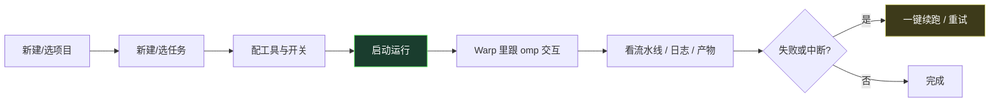

# Web 操作台使用指南

面向日常使用的可视化入口：在浏览器里管项目、跑 SDD 流水线、看日志与产物、续跑/重试。  
引擎原理、节点设计、CLI `./start.sh` 等见 [README.md](./README.md)（本文只讲 **怎么用 UI**）。

默认地址：`http://127.0.0.1:8787/#/workbench`

---

## 1. 五分钟上手

### 1.1 启动

在仓库根目录：

```bash
git clone https://github.com/BeyondNothing/loop-ai-sdd-workflow-with-ui.git
cd loop-ai-sdd-workflow-with-ui
./start_ui.sh
```

浏览器打开：

```text
http://127.0.0.1:8787/#/workbench
```

| 场景 | 命令 |
|------|------|
| 已装过依赖，快速再起 | `SKIP_INSTALL=1 ./start_ui.sh` |
| 改监听地址/端口 | `UI_HOST=0.0.0.0 UI_PORT=8787 ./start_ui.sh` |
| 停服务 | 终端 `Ctrl+C`；或 `lsof -i :8787 -t \| xargs kill` |
| 改前端代码（热更新） | `./start_ui_dev.sh` → 前端 `5666`，API 仍 `8787` |

前置：Python 3.10+、Node 20+、pnpm；真实跑节点还需本机已登录的 `omp` / Cursor / Claude 等 CLI。

### 1.2 左侧菜单

| 菜单 | 路径 | 干什么 |
|------|------|--------|
| **SDD 操作台** | `#/workbench` | 选项目 / 任务、启动运行、看流水线与日志（主战场） |
| **规则目录** | `#/rule-dirs` | 管理 RuleSet，绑定各节点要用的规范 md |
| **运行指标** | `#/metrics` | 近几日耗时、失败率、卡点节点 |
| **系统设置** | `#/settings` | 默认工具、置信度、MCP / Skill 连通探测 |

---

## 2. 操作台怎么用（核心）

界面大致三块：**项目列表 → 任务列表 → 右侧运行详情**（任务配置 / 流水线 / 优先级看板 / 执行历史 / 日志）。



### 2.1 新建项目

1. 操作台左上角 **+**（新建）
2. 填写：
   - **名称**（展示用）
   - **业务工程根目录 `app_root`**（建议绝对路径，例如 `~/IdeaProjects/deepin`）
   - 可选：目录不存在时创建、创建后自动初始化、绑定 RuleSet
3. 保存后会同步工作流配置 / Skill / MCP 等到业务工程侧

仓库不必嵌在业务工程里；在操作台绑定 `app_root` 即可。

**不要**把业务工程长期放在 `~/Downloads`、`~/Desktop`、`~/Documents`（macOS 易 EPERM，见 §5）。

### 2.2 新建任务并运行

1. 在选中项目下 **新建任务**
2. 填写需求名、需求正文，或选择已有 PRD / 需求文件
3. 在 **任务配置** 里确认：
   - **工具**：常用 `omp`（Oh My Pi）；也可 Cursor / Claude 等
   - **无界面**：关 = 交互节点走 Warp（推荐）；开 = 尽量无界面（交互体验差，一般别开）
   - **跳过澄清 / 自动**：按需要勾选
4. 点 **启动 / 运行**（按文档续跑时不要勾「全新」）

### 2.3 运行中看什么

| Tab | 用途 |
|-----|------|
| **任务配置** | 改工具、开关；查看当前任务参数 |
| **流水线** | 各节点进度、产物预览、**从此续跑** |
| **优先级看板** | 任务/节点优先级视图 |
| **执行历史** | 同任务多次 run；可对比、导出 |
| **日志** | 实时日志；失败时优先看这里 |

产物可在流水线节点上预览；弹窗内切换节点会更新预览内容。

### 2.4 失败 / 中断 / 续跑

| 状态 | 含义 | 建议操作 |
|------|------|----------|
| **失败** | 节点或编排报错 | **一键重试**（默认按卡点续跑，不删产物） |
| **中断** | 服务重启等导致（非你点的取消） | **一键续跑** |
| **已取消** | 手动取消 | 可重试；强制取消后锁会释放 |
| **排队** | 等同一项目锁 | 等前一个结束，或对卡死项「一键修复」 |

其它入口：

- 流水线节点上的 **从此续跑**：从指定节点往后跑（不删已有 md）
- **全新重跑**：会清该需求下产物后再来（慎用）
- 顶栏失败条：**看日志** / **一键重试**

说明：每个交互节点仍对应一次 omp 启动（节点间不共享 AI 会话，上下文靠 `docs/` 传递）。macOS 上若 Warp 已打开，后续节点会**尽量复用同一 Warp 窗口**注入下一条命令，而不是每次都新开窗。

### 2.5 项目整包导入 / 导出

- **导出整包**：可勾选是否包含 runs（含 runs 体积大；迁移配置时建议关掉）
- **导入整包**：直传 zip；默认不导入历史 runs；会生成新项目 id，不覆盖现有绑定
- 单次 zip 有大小上限（约 50MB）；过大请去掉 runs 再导出

---

## 3. 规则目录 / 指标 / 设置

### 3.1 规则目录（`#/rule-dirs`）

- 创建 RuleSet，挂载规范 markdown
- 在项目向导或项目编辑里绑定 RuleSet → 各节点按配置注入规则
- 业务规则正文通常在 `app_root/ai-rules/`（细节见 README §7）

### 3.2 运行指标（`#/metrics`）

- 近几日运行耗时、失败率、常见卡点节点
- 用来看哪一阶段最容易挂，而不是替代单次日志排查

### 3.3 系统设置（`#/settings`）

- 默认 AI 工具等全局偏好
- **MCP / Skill 连通探测**：一键检查本机环境是否通

---

## 4. 推荐日常流程（checklist）

1. `./start_ui.sh` → 打开 workbench  
2. 选对 **项目**（`app_root` 指向真实业务仓）  
3. 选/建 **任务**（需求名与 `docs/<需求名>/` 对应）  
4. 工具选 **omp**，**无界面 = 关**  
5. 启动 → 在 Warp 里完成当前节点交互（写产出 / 过门禁）  
6. 流水线变绿后进入下一节点；失败则看 **日志** → **一键续跑**  
7. 全部完成后在流水线预览产物，需要时 **导出 Run** 或项目整包  

---

## 5. macOS · Warp 与权限

交互节点（默认）通过 Warp 跑 `omp`：

- 启动脚本在 `~/.ai4se/warp/ai4se_warp_*.sh`
- 业务目录用 `omp --cwd <app_root>`，不把 shell cwd 硬放到受限目录
- **Warp 已在运行**：复用当前窗口并注入下一节点命令  
- **Warp 未运行**：才会 `new_window` 打开新窗  
- 进程名可能是 `stable`，属正常（操作台已按 Warp.app 识别）

### 5.1 磁盘权限（Downloads / Desktop / Documents）

若项目在上述目录，常见：

```text
EPERM: operation not permitted
Cannot change working directory to .../Downloads/...
```

处理：

1. **系统设置 → 隐私与安全性 → 完全磁盘访问**：勾选 **Warp**、**omp**（`~/.local/bin/omp`）
2. ⌘Q 完全退出并重启 Warp，再在操作台重试
3. 仍失败：把项目挪到如 `~/IdeaProjects/...`，更新项目的 `app_root`

### 5.2 自动化权限（自动键入命令）

**系统设置 → 隐私与安全性 → 自动化**：允许 Terminal / Cursor 控制 **Warp**、**System Events**。  
未自动键入时，日志里会有手动命令，可复制到 Warp 执行。

调试时可关 Warp 桥接：`AI4SE_WARP_BRIDGE=0`。

---

## 6. 常见问题

| 现象 | 怎么处理 |
|------|----------|
| 页面打不开 | 确认 `./start_ui.sh` 在跑；端口 `8787` 未被占用 |
| 一直排队 | 同项目有未结束 run 占锁；等结束或「一键修复」/取消卡死项 |
| 服务一重启任务变「中断」 | 预期行为；点 **一键续跑** |
| 续跑报「未知节点: oh_my_pi」 | 旧心跳曾把工具名写成节点名；升级后应已修复，再点续跑 |
| 每个节点都新开 Warp | 确认已是最新代码；日志应出现「复用已有 Warp 窗口」；先开着 Warp 再跑下一节点 |
| 日志提示手动执行 bash 脚本 | 自动化权限不足；按 §5.2 授权或手动粘贴 |
| 导入 zip 失败 / 过大 | 导出时关掉「含 runs」；单包约 ≤50MB |
| 想纯 CLI 跑同一套流程 | 见 README §1.3 `./start.sh` |

---

## 7. 数据落在哪

操作台状态在 `.dev-workflow/web-ui/`（已 gitignore）：

| 路径 | 内容 |
|------|------|
| `bindings.json` | 项目绑定 |
| `tasks.json` | 任务（含 `last_run_id`） |
| `runs.json` | 运行记录 |
| `runtime/<project_id>/` | 单次 run 运行时副本 |

业务产出仍在 **`app_root/docs/<需求名>/`**，与 CLI 跑法一致。

---

## 8. 补充说明（链到 README）

| 主题 | 文档位置 |
|------|----------|
| 仓库接入业务工程、CLI 启动 | [README §1](./README.md#1-接入与启动) |
| 设计目标 / 原则 / 架构 | [README §2–4](./README.md#2-设计目标) |
| 节点一览、续跑与门禁 | [README §5](./README.md#5-workflow-流程) |
| 测试分工、ai-rules、产出链 | [README §6–8](./README.md#6-测试设计) |
| 节点配置、状态、目录结构 | [README §9–11](./README.md#9-节点配置三要素) |
| 扩展节点 / 工具 | [README §12](./README.md#12-扩展指南) |
| 依赖列表 | [README §14](./README.md#14-依赖) |

README 里原来的 **§13 Web 操作台** 仍保留启动与权限摘要；**完整用法以本文为准**。
