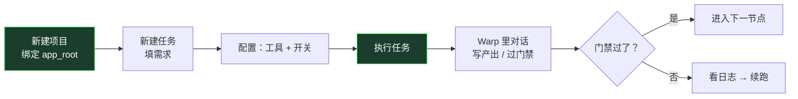

# Web 操作台使用指南

在浏览器里管项目、跑流水线、看产物、处理 QA。

面向**日常操作**。流水线每一步在做什么、产出文档长什么样，见 [README.md](./README.md)。

访问地址：<http://127.0.0.1:8787/#/workbench>

---

## 1. 启动

```bash
git clone https://github.com/BeyondNothing/loop-ai-sdd-workflow-with-ui.git
cd loop-ai-sdd-workflow-with-ui
./start_ui.sh
```

首次会创建 `.venv`、装 Python 依赖、构建前端；之后再起会快很多。

| 场景 | 命令 |
|------|------|
| 已装过依赖 | `SKIP_INSTALL=1 ./start_ui.sh` |
| 改监听地址 / 端口 | `UI_HOST=0.0.0.0 UI_PORT=8787 ./start_ui.sh` |
| 改前端代码（热更新） | `./start_ui_dev.sh` → 前端 5666，API 仍 8787 |
| 停止 | 终端 `Ctrl+C` |
| 端口被占用 | `lsof -i :8787 -t \| xargs kill` |

前置：Python 3.10+、Node 20+、pnpm；真实跑节点还需本机已登录的 AI CLI。

---

## 2. 界面地图

左侧四个菜单：

| 菜单 | 路径 | 用途 |
|------|------|------|
| **SDD 操作台** | `#/workbench` | 选项目 / 任务、启动运行、看流水线（主战场） |
| **规则目录** | `#/rule-dirs` | 管理 RuleSet，绑定各节点要用哪些规范 |
| **运行指标** | `#/metrics` | 近几日耗时、失败率、最常卡住的节点 |
| **系统设置** | `#/settings` | 默认工具、MCP / Skill 连通探测 |

操作台本身分三栏：**项目列表 → 任务列表 → 右侧详情**。右侧详情有六个 Tab。

---

## 3. 第一次使用



### 3.1 新建项目

点左上角 **+**，填写：

- **名称** —— 只是展示用
- **业务工程根目录 `app_root`** —— 建议绝对路径，如 `~/IdeaProjects/deepin`
- 可选：目录不存在时创建、创建后自动初始化、绑定 RuleSet

保存后会同步 `sdd-loop-workflow-config` / Skill / MCP 到业务工程侧。

> 仓库本身不需要嵌进业务工程，在操作台绑定 `app_root` 就够了。

### 3.2 新建任务

在选中项目下点 **新建任务**，填需求名 + 需求正文，或选一个已有的 PRD 文件。

需求名决定产出目录：`<app_root>/docs/<需求名>/`。

### 3.3 配置运行参数

在 **任务配置** Tab 里：

| 选项 | 建议 | 说明 |
|------|------|------|
| **工具** | `omp` | 也可 Cursor / Claude / Codex |
| **无界面** | **关** | 关 = 交互节点走 Warp，你能实时对话；开 = 尽量无界面，交互体验差 |
| **跳过澄清** | 按需 | 需求已写清楚时可以勾 |
| **自动** | 慎用 | 内容就绪即过门禁，不等你确认 |

然后点 **执行任务**。

---

## 4. 六个 Tab

| Tab | 看什么 |
|-----|--------|
| **任务配置** | 工具、开关、需求正文 |
| **流水线** | 节点进度表、运行时间线、产物速览 |
| **QA 质量** | 发布置信度、质量问题、用例明细 |
| **优先级看板** | 全项目任务按「卡住 / 待确认 / 可发布 / 运行中」分组 |
| **执行历史** | 同任务多次 run，可 A/B 对比 |
| **日志** | 实时日志，失败先看这里 |

### 4.1 流水线

节点顺序：

```text
需求 → 计划/用例 → 评审 → 任务拆分 → 技术方案 → API 设计 → 代码实现 → 测试 → AI 评审 → 提交
```

每个节点一行，能看到状态、产物、以及三个按钮：

- **侧栏 / 弹窗 / 打开** —— 预览产出文档
- **从此续跑** —— 从该节点往后跑，不删已有产物
- **只跑一步** —— 只跑这一个节点

节点状态：

| 状态 | 含义 |
|------|------|
| 已完成 | 有产物且门禁已过 |
| 运行中 | 正在跑 |
| 排队 | 等锁 |
| 跳过 | 该节点未产出（如 `--auto` 跳过的） |
| 未开始 | 还没轮到 |

### 4.2 QA 质量

这个 Tab 专门管质量，和流水线解耦。

**概览区**

- **发布置信度** —— 从 `05-test-report.md` 解析的 0-1 分数，0.8 以上标绿
- **QA 审批状态** —— 用例是否经 QA 审过（异步，不阻塞流水线）
- **四个 KPI** —— 用例总数 / 通过 / 失败阻塞 / 跳过

**质量问题**

只列需要处理的东西：未通过的用例（`fail` / `blocked`）+ 报告里「问题与建议」章节的条目。

**用例明细**

表格列出每条用例：编号、名称、类型、优先级、结果。支持按「全部 / 失败 / 跳过 / 通过」筛选。

**点任意一行（或编号）** 打开用例详情弹窗：

- 顶部标签：结果、类型、优先级、是否可自动执行
- 主体：该用例在 `02-test-cases.md` 里的完整明细（输入、期望、覆盖规则）
- 底部：一键打开测试用例文档 / 测试报告

**查看评分依据** —— 在置信度卡片下方，弹出报告里「置信度评估」整段内容（评分维度表、扣分说明、补测记录）。

> 用例名称、类型、优先级来自 `02-test-cases.md` 的「用例总览」表，明细来自 `### TC-XXX-001` 章节。两者都由后端解析后随接口一起返回。

### 4.3 执行历史

每次 run 一行，包含状态、耗时、卡点节点。

- 点 **选** 勾两条 run → **对比 A/B**，逐节点比对产物差异
- 点 **对比上次成功** 快速看当前 run 与上次成功 run 的差别
- **导出** 单个 run 的全部内容（日志 / 时间线 / 产物）

---

## 5. 失败、中断、续跑

| 状态 | 什么情况 | 怎么办 |
|------|----------|--------|
| **失败** | 节点报错或编排异常 | **一键重试**（默认从卡点续跑，不删产物） |
| **中断** | 服务重启导致（不是你取消的） | **一键续跑** |
| **已取消** | 你手动取消的 | 可重试；强制取消会释放项目锁 |
| **排队** | 同项目有 run 占着锁 | 等它结束，或取消卡死那条 |

失败时页面顶部会有红色提示条，带 **一键重试** 和 **看日志** 按钮。

### 续跑的三种粒度

| 粒度 | 入口 | 行为 |
|------|------|------|
| 整条重试 | 顶部提示条 | 从自动识别的卡点节点继续 |
| 从指定节点 | 流水线行的「从此续跑」 | 从你选的那个节点往后 |
| 只跑一步 | 流水线行的「只跑一步」 | 只执行这一个节点 |

**全新重跑** 会清空该需求目录下的产物再从头来，慎用。

### 为什么每个交互节点都要重新启动 CLI

节点之间不共享 AI 会话 —— 这是设计，不是 bug。上下文全靠 `docs/` 里的 md 传递。好处是单节点失败可以单独重跑，不会污染其他阶段。

macOS 上这些 CLI 通过 Warp 启动。**Warp 已在运行时会复用当前窗口**（先 `Ctrl+C` 中断上一个会话，再注入新命令），只在 Warp 没开时才新开窗口。

---

## 6. 项目导入导出

**导出整包** —— 打包项目绑定、任务、配置、规则。

可以选择是否包含 runs：

- 不含 runs（默认）：体积小，适合迁移配置
- 含 runs：保留完整历史，体积大

单包上限约 50MB。超了就去掉 runs 再导。

**导入整包** —— 直传 zip。会生成新的项目 id，不会覆盖现有绑定。runs 默认不导入。

---

## 7. 规则目录

`#/rule-dirs` 管理 RuleSet：一组规范 md 的集合。

工作方式：

1. 创建一个 RuleSet，指向某个规则文件夹
2. 在项目向导或项目编辑里绑定它
3. 各节点按 `ai-rules.yaml` 的配置注入对应规则

规则正文通常在业务工程的 `sdd-loop-workflow-config/ai-rules/` 下。引擎侧也有一份通用的 `ai-rules/`，业务侧会覆盖它。

---

## 8. macOS 权限（重要）

### 8.1 磁盘访问

业务工程放在 `~/Downloads`、`~/Desktop`、`~/Documents` 时，macOS 的 TCC 会拦截，典型报错：

```text
EPERM: operation not permitted
Cannot change working directory to .../Downloads/...
```

解决：

1. **系统设置 → 隐私与安全性 → 完全磁盘访问权限**
2. 添加并勾选 **Warp**（`/Applications/Warp.app`）和 **omp**（`~/.local/bin/omp`）
3. ⌘Q 完全退出 Warp，再打开
4. 回到操作台重试

还是不行的话，把项目挪到 `~/IdeaProjects/` 之类的位置，更新项目的 `app_root`。

### 8.2 自动化权限

操作台需要往 Warp 窗口里键入命令：

**系统设置 → 隐私与安全性 → 自动化** —— 允许 Terminal / Cursor 控制 **Warp** 和 **System Events**。

没授权时会退化成「日志里给你一条手动命令」，复制到 Warp 里执行即可。

### 8.3 关掉 Warp 桥接

调试时可以完全绕过 Warp：

```bash
AI4SE_WARP_BRIDGE=0 ./start_ui.sh
```

---

## 9. 数据存在哪

操作台自身状态在 `.dev-workflow/web-ui/`（已 gitignore）：

| 路径 | 内容 |
|------|------|
| `bindings.json` | 项目绑定 |
| `tasks.json` | 任务列表（含 `last_run_id`） |
| `runs.json` | 运行记录（重启可恢复） |
| `rule-sets.json` | RuleSet |
| `runtime/<project_id>/` | 单次 run 的运行时配置副本 |

业务产出在 `<app_root>/docs/<需求名>/`，和 CLI 跑法完全一样。

浏览器端还存了一点偏好（`localStorage`）：

- `ai-loop:workbench:last-project` —— 上次打开的项目
- `ai-loop:workbench:prefs:<projectId>` —— 该项目的工具/开关 + 上次选的任务

所以再进来会自动回到上次的项目和任务。

---

## 10. 常见问题

| 现象 | 处理 |
|------|------|
| 页面打不开 | 确认 `./start_ui.sh` 在跑；检查 8787 端口 |
| 页面白屏 | 前端产物与源码不同步：`cd webui && pnpm build`，重启服务，`Cmd+Shift+R` 强刷 |
| 一直排队 | 同项目有 run 占锁。等它结束，或取消卡死那条 |
| 服务重启后变「中断」 | 预期行为，点「一键续跑」 |
| 续跑报「未知节点: oh_my_pi」 | 旧版本把工具名写进了节点名，升级后已修复 |
| 每个节点都新开 Warp | 应复用窗口。确认代码最新；日志里应出现「复用已有 Warp 窗口」 |
| 日志提示手动执行 bash 脚本 | 自动化权限不足，见 §8.2 |
| 导入 zip 失败 | 检查是否超 50MB，去掉 runs 再导 |
| 用例明细没显示 | 该任务的 `02-test-cases.md` 或 `05-test-report.md` 还没生成 |
| 想纯 CLI 跑 | `./start.sh`，见 [README §1.4](./README.md#14-方式二命令行) |
